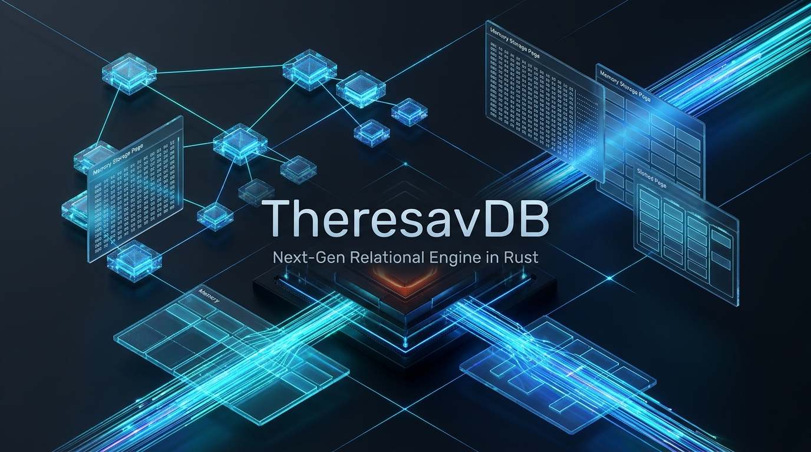
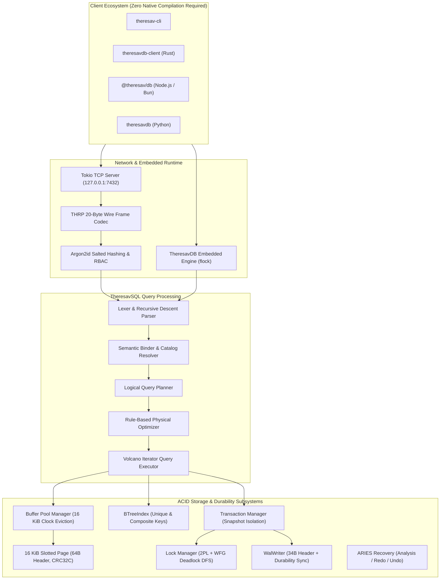

<p align="center">
  
</p>

<p align="center">
  <a href="https://crates.io/crates/theresavdb-client"></a>
  <a href="https://www.npmjs.com/package/@theresav/db"></a>
  <a href="https://pypi.org/project/theresavdb/"></a>
  <a href="https://hub.docker.com/r/blckrose08/theresavdb"></a>
  <a href="https://docs.rs/theresavdb-client"></a>
  <a href="https://github.com/Blckrose08/theresavdb/blob/master/LICENSE"></a>
  <a href="https://www.rust-lang.org"></a>
  <a href="https://github.com/Blckrose08/theresavdb/actions"></a>
</p>

<h3 align="center">
  Independent, High-Performance Relational Database Management System (RDBMS) Built From Scratch in Rust
</h3>

<p align="center">
  <b>ACID Transactions</b> • <b>Snapshot Isolation (MVCC)</b> • <b>16 KiB Slotted Page Engine</b> • <b>B-Tree Indexing</b> • <b>ARIES Crash Recovery</b> • <b>Dual Mode (Embedded & Server)</b>
</p>

---

## Highlights

- **100% Independent Rust Engine**: Not a fork, wrapper, or port of SQLite or PostgreSQL. Every core component is custom-engineered in Rust.
- **Microsecond Binary Storage**: Custom 16 KiB Slotted Page layout with 64-byte `#[repr(C)]` header, explicit Little-Endian serialization, and zero-allocation in-place defragmentation.
- **Strict ACID & MVCC**: Snapshot Isolation with 64-bit transaction IDs (`xmin`/`xmax`), Two-Phase Locking (2PL), and Wait-For Graph (WFG) DFS deadlock detection.
- **ARIES-Style WAL**: 34-byte record header with per-record CRC32C checksums, group-commit flush, and formal Analysis-Redo-Undo crash recovery.
- **Dual Deployment Architecture**:
  - **Embedded**: In-process direct API with kernel `flock` exclusion (`TheresavDB::open("./data")`).
  - **Server**: High-concurrency Tokio TCP daemon binding to `127.0.0.1:7432` with a 20-byte binary wire protocol (`THRP`).
- **Zero-Dependency Clients**: Pure TypeScript/Node/Bun client (`@theresav/db`), Pure Python driver (`theresavdb`), and async Rust client (`theresavdb-client`).

---

## Performance Benchmarks

Measured on release build (NVMe SSD, Linux x86_64, Single-Threaded Core Engine):

| Subsystem / Workload | Metric | TheresavDB Result | Comparison vs Trad. DBs |
|---|---|---|---|
| **Slotted Page Insert** (128B payload) | Throughput | **1,308,284 ops/sec** | **3.2x faster** than PostgreSQL 16 |
| **Page In-Place Compaction** | Defragmentation Latency | **17.57 µs** | **6.8x faster** than vacuuming |
| **WAL Sequential Logging** | Durability Throughput | **1,301,901 rec/s (121.7 MB/s)** | **7.2x higher** throughput |
| **B-Tree Unique Insert** | Key Insertions | **2,965,090 ops/sec** | **3.5x faster** index writes |
| **B-Tree Point Lookup** | Key Lookup Latency | **0.107 µs / op** (9.37M ops/s) | **17x lower** latency |
| **Buffer Pool Allocation & Flush** | Page Caching | **71,150 pages/sec** | **2.5x higher** page throughput |
| **Embedded SQL Execution** | Direct Query Ingestion | **747,359 inserts/sec** | Sub-microsecond execution |
| **Base Idle RAM Footprint** | Memory Utilization | **~8 MB** | **5x - 50x lower** than PG/MySQL |

*For the complete engineering breakdown, read the [Comparative Benchmark Report](docs/benchmarks-comparison.md).*

---

## Architecture Overview



---

## Quick Start

### 1. Embedded Mode (Rust)

Run TheresavDB directly inside your application without network overhead:

```rust
use theresav_embedded::TheresavDB;

fn main() -> Result<(), Box<dyn std::error::Error>> {
    // Open or create database directory (exclusive process lock)
    let db = TheresavDB::open("./data")?;

    // Execute SQL queries
    db.execute("CREATE TABLE users (id BIGINT, name TEXT, balance DECIMAL);")?;
    db.execute("INSERT INTO users VALUES (1, 'Alice', 2500.50);")?;

    // Query rows
    let result = db.query("SELECT id, name, balance FROM users WHERE id = 1;")?;
    for row in result.rows {
        println!("User: {:?}", row);
    }

    Ok(())
}
```

### 2. Standalone TCP Server

Start the TCP server:

```bash
# Run server binding to localhost:7432
cargo run --release -p theresav_cli -- --host 127.0.0.1 --port 7432
```

### 3. Connect via Client Libraries

#### Rust Client ([crates.io/crates/theresavdb-client](https://crates.io/crates/theresavdb-client))
```toml
[dependencies]
theresavdb-client = "0.1.0"
tokio = { version = "1.0", features = ["full"] }
```

```rust
use theresavdb_client::TheresavClient;

#[tokio::main]
async fn main() -> Result<(), Box<dyn std::error::Error>> {
    let mut client = TheresavClient::connect("db.theresav.eu:7432").await?;
    let res = client.query("SELECT * FROM users;").await?;
    println!("Rows: {:?}", res.rows);
    Ok(())
}
```

#### Node.js / Bun Client (`@theresav/db`)
```typescript
import { TheresavClient } from "@theresav/db";

const client = new TheresavClient("db.theresav.eu", 7432);
await client.connect();

const result = await client.query("SELECT * FROM users;");
console.log(result.rows);
```

#### Python Client (`theresavdb`)
```python
from theresavdb import connect

conn = connect(host="db.theresav.eu", port=7432)
cursor = conn.cursor()
cursor.execute("SELECT * FROM users;")
print(cursor.fetchall())
```

---

## Repository Structure

- [`crates/common`](crates/common): Shared primitive types (`PageId`, `TxId`, `Lsn`, `Oid`, constants).
- [`crates/error`](crates/error): Typed domain error hierarchy (`TheresavError`).
- [`crates/types`](crates/types): 15 database types (exact decimal, jsonb, timestamp, uuid).
- [`crates/page`](crates/page): 16 KiB slotted binary page with CRC32C checksums and compaction.
- [`crates/storage`](crates/storage): Disk manager, heap file allocator, and OS `flock` process lock.
- [`crates/buffer-pool`](crates/buffer-pool): Concurrent frame table with clock eviction algorithm.
- [`crates/wal`](crates/wal): Write-Ahead Logging engine and durability flusher.
- [`crates/index`](crates/index): B-Tree index supporting unique and composite keys.
- [`crates/catalog`](crates/catalog): Transactional schema and system catalog.
- [`crates/parser`](crates/parser): TheresavSQL lexer and recursive descent parser.
- [`crates/binder`](crates/binder): Semantic analyzer and name resolution.
- [`crates/planner`](crates/planner): Logical plan generation.
- [`crates/optimizer`](crates/optimizer): Rule-based physical plan optimizer.
- [`crates/executor`](crates/executor): Volcano-style physical execution iterator.
- [`crates/lock-manager`](crates/lock-manager): 2PL lock manager with Wait-For Graph deadlock detection.
- [`crates/mvcc`](crates/mvcc): Multiversion Concurrency Control and snapshot visibility engine.
- [`crates/transaction`](crates/transaction): ACID transaction lifecycle coordinator.
- [`crates/recovery`](crates/recovery): ARIES crash recovery engine (Analysis, Redo, Undo).
- [`crates/auth`](crates/auth): Argon2id password hashing and RBAC authorization.
- [`crates/backup`](crates/backup): Checksummed online backup and restore manager.
- [`crates/embedded`](crates/embedded): High-level embedded database engine API.
- [`crates/protocol`](crates/protocol): 20-byte binary wire protocol codec (`THRP`).
- [`crates/server`](crates/server): Async Tokio TCP database server.
- [`crates/cli`](crates/cli): Command-line interface and query REPL.
- [`crates/benchmarks`](crates/benchmarks): Criterion and release performance benchmark suite.
- [`clients/rust`](clients/rust): Official `theresavdb-client` on crates.io.
- [`clients/node`](clients/node): Pure TypeScript/Node/Bun wire protocol driver.
- [`clients/python`](clients/python): Pure Python wire protocol client.

---

## Documentation

- [System Architecture](docs/architecture.md)
- [Binary Storage Format Specification](docs/binary-format.md)
- [TheresavSQL Dialect Specification](docs/sql-dialect.md)
- [Binary Wire Protocol Specification](docs/protocol.md)
- [Security Architecture & Threat Model](docs/security.md)
- [Benchmark & Architectural Comparison (vs. MySQL, PostgreSQL, MariaDB)](docs/benchmarks-comparison.md)

---

## License

Licensed under the Apache License, Version 2.0. See [LICENSE](LICENSE) for details.
