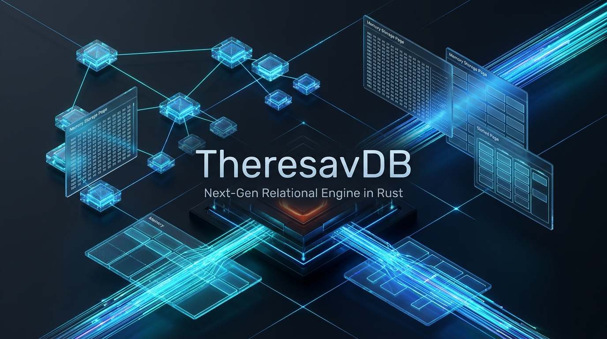

# @theresav/db

Official Node.js & Bun driver for [TheresavDB](https://github.com/Blckrose08/theresavdb) relational database engine.

<p align="center">
  
</p>

## Overview

`@theresav/db` is a lightweight, zero-dependency Node.js and Bun driver communicating directly over TheresavDB's binary wire protocol (`THRP`). It does not require a local Rust toolchain or native C++ addons (`node-gyp`).

## Installation

```bash
npm install @theresav/db
```

Or with Bun:

```bash
bun add @theresav/db
```

## Quick Start

```typescript
import { TheresavClient } from "@theresav/db";

async function main() {
  const client = new TheresavClient("db.theresav.eu", 7432);
  await client.connect();

  await client.query("CREATE TABLE users (id BIGINT, name TEXT, balance DECIMAL);");
  await client.query("INSERT INTO users VALUES (1, 'Alice', 1500.50);");

  const result = await client.query("SELECT * FROM users;");
  console.log("Columns:", result.columns);
  console.log("Rows:", result.rows);
}

main().catch(console.error);
```
