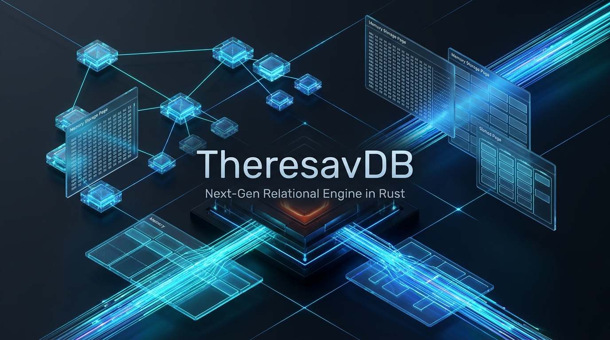

<p align="center">
  
</p>

# theresavdb-client

Official async Rust client library for [TheresavDB](https://github.com/Blckrose08/theresavdb) relational database engine.

## Installation

Add to your `Cargo.toml`:

```toml
[dependencies]
theresavdb-client = "0.1.0"
tokio = { version = "1.0", features = ["full"] }
```

Or via `cargo add`:

```bash
cargo add theresavdb-client
```

## Quick Start

```rust
use theresavdb_client::TheresavClient;

#[tokio::main]
async fn main() -> Result<(), Box<dyn std::error::Error>> {
    let mut client = TheresavClient::connect("127.0.0.1:7432").await?;

    client.execute("CREATE TABLE users (id BIGINT, name TEXT);").await?;
    client.execute("INSERT INTO users VALUES (1, 'Alice');").await?;

    let result = client.query("SELECT * FROM users;").await?;
    println!("Columns: {:?}", result.columns);
    for row in result.rows {
        println!("Row: {:?}", row);
    }

    Ok(())
}
```
